  

  <a href="README.md">Home</a> ·
  <a href="SECURITY.md">Security</a> ·
  <a href="CONTRIBUTING.md">Contributing</a> ·
  <b>Code of Conduct</b> ·
  <a href="LICENSE">License</a>

---

## Our pledge

We want participation in this project to be a respectful, harassment-free experience for everyone, regardless of age, body size, disability, ethnicity, gender identity and expression, level of experience, nationality, personal appearance, race, religion, or sexual identity and orientation.

## Standards

| Expected | Not acceptable |
|---|---|
| Being respectful and constructive, including when you disagree | Harassment, insults, discrimination or personal attacks |
| Giving and accepting feedback graciously | Sexualized language or imagery, and unwelcome sexual attention |
| Focusing on what is best for the project and its users | Threats or intimidation |
| Protecting the privacy of others and of customer data | Publishing others' private information, including contracts, credentials or customer data, without permission |

Any other conduct that would reasonably be considered inappropriate in a professional setting is also unacceptable.

## Enforcement

The project owner is responsible for clarifying and enforcing these standards. They may remove, edit or reject comments, commits, issues and other contributions that do not follow this Code of Conduct, and may temporarily or permanently ban anyone for behavior they consider inappropriate, threatening or harmful.

## Scope

This applies in all project spaces (issues, pull requests, discussions) and when someone represents the project in public.

## Reporting

> [!NOTE]
> Report violations privately to <CONDUCT_EMAIL>. All reports are reviewed and handled confidentially.

## Attribution

Adapted from the [Contributor Covenant](https://www.contributor-covenant.org), version 2.1, licensed under CC BY 4.0.

---

<a href="README.md">← Back to README</a>

