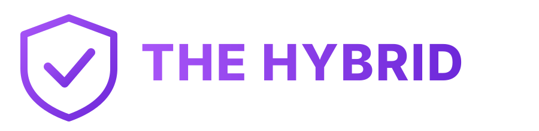
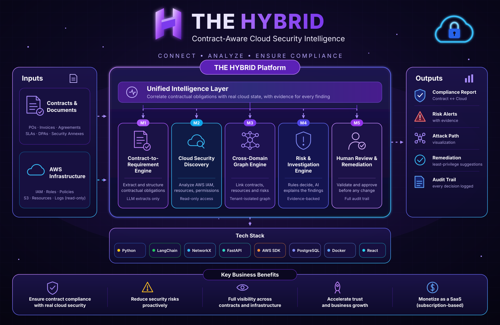
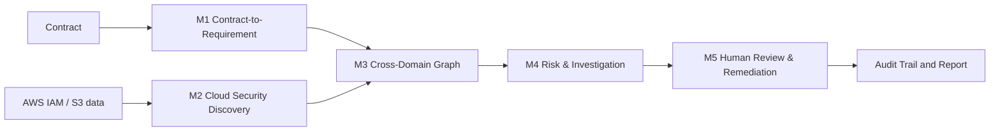

<p align="center">

</p>

<h3 align="center">Contract-aware cloud security, investigated by AI agents. Decided by people.</h3>

<p align="center">
  Vendora reads the contracts. AEGIS maps the cloud. THE HYBRID checks whether what was promised is what is real, shows the evidence, and holds any change until a person approves.
</p>

<p align="center">
  
  
  
  
  
  
</p>

---

## The problem

Enterprise contracts contain security commitments such as *"customer data must only be accessible to authorized roles"*. Cloud security tools see IAM policies and attack paths, but they do not know which contract each resource is bound to. Compliance teams read contracts, but they cannot verify the live infrastructure.

The same IAM policy can be harmless under one contract and a breach of another. THE HYBRID answers one question:

> **Does our real cloud infrastructure comply with the security commitments we signed?**

## Architecture



## How it works



**Example finding**

| Field | Value |
|---|---|
| Contract clause | 4.2: only authorized roles may access customer data |
| Resource | S3 customer-data bucket |
| Identity | IAM role with broad permissions |
| Finding | Excessive access path |
| Evidence | IAM policy + attack-path graph |
| Recommendation | Apply least privilege |
| Action | Human approval required |

## What works today

- **Contract extraction** with fail-closed validation and grounding: a requirement is only accepted if it can be tied back to the contract text.
- **Hardened against untrusted contracts:** prompt-injection and no-access-clause cases are part of the test suite.
- **Unified data model** linking clauses, requirements, resources, identities, findings and evidence.
- **AEGIS adapter:** reads IAM analysis from AEGIS and applies rules such as clause-vs-IAM excess access and unauthorized access paths.
- **Approval workflow:** extracted requirements are proposals until a human approves them, with a full audit trail.
- **Remediation advice** with a what-if check before anything is recommended.
- **Multi-tenant API:** API keys map to tenants, and data is isolated per tenant.
- **Snapshots, scans and reports:** scan an IAM snapshot against approved requirements and generate a report.
- **Drift detection:** new, resolved, persisting and changed findings, plus a scan-diff endpoint with tenant isolation.
- **CI** runs the full test suite on every push.

## Modules

| Module | Purpose |
|---|---|
| **M1 Contract-to-Requirement** | Extracts obligations from contracts and turns them into structured, testable requirements. |
| **M2 Cloud Security Discovery** | Ingests AWS data (IAM users, roles, policies, S3 buckets, resource policies) and maps relationships and access paths. |
| **M3 Cross-Domain Graph** | Unified graph connecting clauses, requirements, resources, identities and findings. |
| **M4 Risk & Investigation** | Deterministic rules and graph analysis decide; the LLM only explains and gathers evidence. |
| **M5 Human Review & Remediation** | Evidence review, least-privilege suggestions, what-if comparison, approvals and audit trail. |

## Design principles

- **Rules decide, the LLM explains.** The LLM extracts clauses and writes explanations. Violations come from code and graph analysis, never from a model's opinion.
- **Fail closed.** Ungrounded or invalid extraction output is rejected, not guessed.
- **Evidence for every finding.** No finding without the policy, path or clause that supports it.
- **Read-only by default.** AWS access uses read-only roles. No automatic changes to customer infrastructure.
- **Human in the loop.** Any requirement or remediation requires explicit approval and is logged.
- **Multi-tenant from day one.** Strict tenant isolation in data and API.
- **Decision support, not legal advice.** The system helps security, compliance and legal teams find and verify risks. It does not issue legal conclusions.

## Unified data model

`Contract → Clause → Security Requirement → AWS Account → IAM Role → IAM Policy → S3 Bucket → Attack Path → Finding → Evidence → Remediation`

The graph engine uses NetworkX. A dedicated graph database will be considered only if data volume requires it.

## Roadmap

- [x] **Phase 1: Integration.** AEGIS adapter and CI integration.
- [x] **Phase 2: Unified data model.**
- [x] **Phase 3: Cross-domain engine.** Clause-to-infrastructure rules on synthetic AWS scenarios.
- [ ] **Phase 4: AI investigation.** Extraction, remediation advice and reports done; investigation agents pending.
- [ ] **Phase 5: Dashboard.** Contracts, resources, risks, evidence and approvals.
- [ ] **Phase 6: Testing and deployment.** CI in place; production hardening below.

**Next up**

- [ ] Test for `resolved` findings in drift
- [ ] PostgreSQL instead of SQLite (migrations, tenant isolation)
- [ ] Scheduled scans and alerts on drift
- [ ] Per-tenant rate limiting on `/contracts`
- [ ] HTTPS via reverse proxy
- [ ] Read-only AWS collector (cross-account role with External ID)

## Tech stack

Python · FastAPI · Pydantic · NetworkX · Gemini (extraction only) · AWS IAM / S3 (read-only) · SQLite (moving to PostgreSQL) · GitHub Actions

## Demo

Run the full chain on the synthetic scenario (no AWS account needed):

```bash
# 1. M1: extract obligations from a contract (Gemini)
python -m hybrid.extract_cli fixtures/scenario-01/contract.md > out/proposals.json

# 2. M5: a human binds each obligation to technical identifiers
python -m hybrid.review_cli out/proposals.json --reviewer reviewer-1

# 3. M2-M4: check approved requirements against an IAM snapshot
python -m hybrid.scan_cli out/requirements.json --snapshot fixtures/scenario-02/iam_real.json
```

## Project policies

- [Contributing](CONTRIBUTING.md)
- [Code of Conduct](CODE_OF_CONDUCT.md)
- [Security Policy](SECURITY.md)
- [License](LICENSE)

## Security

Never commit credentials, customer contracts or real scan results. The `.gitignore` and secret scanning are configured to help prevent this. To report a vulnerability, follow [SECURITY.md](SECURITY.md) and do not open a public issue.

## License

Copyright (c) 2026 <FULL NAME>. All rights reserved.
This repository is proprietary. No permission is granted to use, copy, modify or distribute the code without written consent from the owner. See [LICENSE](LICENSE).

## Related projects

- **AEGIS:** AWS IAM analysis and attack-path engine.
- **VENDORA:** AI-powered procurement and contract document intelligence.
