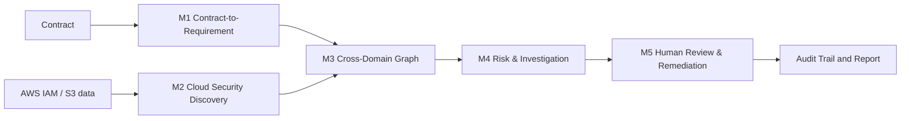

# THE HYBRID

**Contract-aware cloud security intelligence.**
THE HYBRID links the security obligations a company has signed in its contracts to the access that actually exists in its AWS environment, and proves every finding with evidence.

> **Status:** early development (pre-MVP). Architecture and data model are being defined. Nothing here is production-ready.

---

## The problem

Enterprise contracts contain security commitments such as *"customer data must only be accessible to authorized roles"*. Cloud security tools see IAM policies and attack paths, but they do not know which contract each resource is bound to. Compliance teams read contracts, but they cannot verify the live infrastructure.

The same IAM policy can be harmless under one contract and a breach of another. THE HYBRID answers one question:

> **Does our real cloud infrastructure comply with the security commitments we signed?**

## Architecture


## How it works



**Example finding**

| Field | Value |
|---|---|
| Contract clause | 4.2: only authorized roles may access customer data |
| Resource | S3 customer-data bucket |
| Identity | IAM role with broad permissions |
| Finding | Excessive access path |
| Evidence | IAM policy + attack-path graph |
| Recommendation | Apply least privilege |
| Action | Human approval required |

## Modules

| Module | Purpose |
|---|---|
| **M1 Contract-to-Requirement** | Extracts obligations from contracts and turns them into structured, testable requirements. |
| **M2 Cloud Security Discovery** | Ingests AWS data (IAM users, roles, policies, S3 buckets, resource policies) and maps relationships and access paths. |
| **M3 Cross-Domain Graph** | Unified graph connecting clauses, requirements, resources, identities and findings. |
| **M4 Risk & Investigation** | Deterministic rules and graph analysis decide; the LLM only explains and gathers evidence. |
| **M5 Human Review & Remediation** | Evidence review, least-privilege policy suggestions, before/after comparison, approvals and audit trail. |

## Design principles

- **Rules decide, the LLM explains.** The LLM extracts clauses and writes explanations. Violations come from code and graph analysis, never from a model's opinion.
- **Evidence for every finding.** No finding without the policy, path or clause that supports it.
- **Read-only by default.** AWS access uses read-only roles. No automatic changes to customer infrastructure.
- **Human in the loop.** Any remediation requires explicit approval and is logged.
- **Multi-tenant from day one.** Strict tenant isolation in data and graph.
- **Decision support, not legal advice.** The system helps security, compliance and legal teams find and verify risks. It does not issue legal conclusions.

## Unified data model

`Contract → Clause → Security Requirement → AWS Account → IAM Role → IAM Policy → S3 Bucket → Attack Path → Finding → Evidence → Remediation`

The initial graph engine uses NetworkX. A dedicated graph database will be considered only if data volume requires it.

## Roadmap

- [ ] **Phase 1: Integration.** Review and reuse components from AEGIS (IAM and attack-path analysis) and VENDORA (document intelligence).
- [ ] **Phase 2: Unified data model.** Pydantic models and graph schema.
- [ ] **Phase 3: Cross-domain engine.** Clause-to-infrastructure matching on synthetic AWS scenarios.
- [ ] **Phase 4: AI investigation.** Agents for explanation, evidence collection and reports.
- [ ] **Phase 5: Dashboard.** Contracts, resources, risks, evidence and approvals.
- [ ] **Phase 6: Testing and deployment.** Integration and security tests, CI/CD, validation on real AWS with read-only access.

**MVP scope:** one scenario end to end: contract clause → S3 access requirement → IAM attack path → finding with evidence → human review.

## Tech stack (planned)

Python · Pydantic · NetworkX · LLM agents · AWS IAM / S3 (read-only) · FastAPI · PostgreSQL · React dashboard

## Repository layout (planned)

```
the-hybrid/
├── src/            # application code
├── docs/           # architecture.svg and design notes
├── tests/          # unit and integration tests
└── data/           # synthetic sample data (never real customer data)
```

## Security

- Never commit credentials, customer contracts or real scan results. The `.gitignore` and secret scanning are configured to help prevent this.
- Report security concerns privately to the repository owner. Do not open a public issue.

## License

Copyright (c) 2026 <FULL NAME>. All rights reserved.
This repository is proprietary. No permission is granted to use, copy, modify or distribute the code without written consent from the owner.

## Related projects

- **AEGIS:** AWS IAM analysis and attack-path engine.
- **VENDORA:** AI-powered procurement and contract document intelligence.
